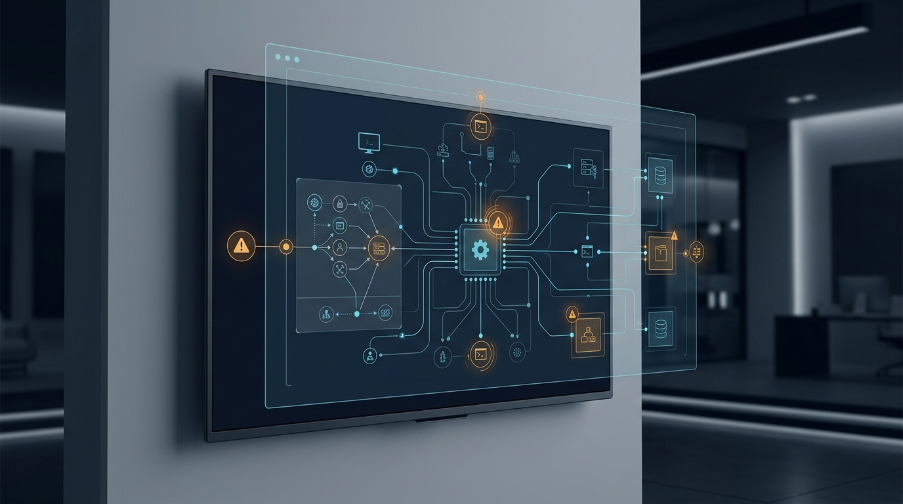

# LG Smart TV Flaws: Remote Root Takeover

Security researchers have disclosed several critical vulnerabilities impacting millions of LG webOS smart TVs, enabling unauthenticated remote attackers to gain full root privileges and execute arbitrary commands across affected devices. These security flaws allow attackers to bypass user authorization, add rogue accounts, and pivot deeper into local home and corporate Wi-Fi networks.\n\nOur latest IoT security report details the root cause mechanisms across webOS versions, active exposure scans, and the urgent firmware update steps needed to safeguard affected displays.\n\nRead the full technical security breakdown on our official portal.

**[Read the full technical breakdown here](https://cyberupdates365.com/lg-smart-tv-flaws-root-takeover/)**

---
*Maintained by Kiran Sonawane | Senior Cloud & DevOps Engineer*
